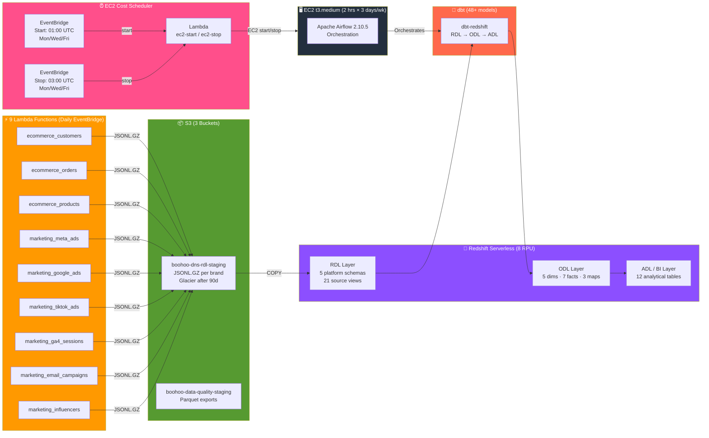

<p align="center">
  <h1 align="center">Boohoo Group Data Pipeline</h1>
  <p align="center">
    <strong>Multi-brand e-commerce data warehouse on AWS — 9 Lambda data generators across 7 brands, Redshift Serverless star schema, dbt medallion architecture (RDL → ODL → ADL), Airflow on a cost-optimised EC2 managed by Lambda + EventBridge.</strong>
  </p>
  <p align="center">
    
    
    
    
    
    
    
    
    
  </p>
</p>

---

## Architecture Overview

A **production-grade, cost-optimised data warehouse** for the Boohoo Group's multi-brand e-commerce ecosystem. **9 Lambda functions** generate data for **7 brands** across **5 e-commerce platforms**, landing as JSONL.GZ in S3. **Redshift Serverless** warehouses the data through a **dbt-driven medallion architecture** (RDL → ODL → ADL) spanning **48+ models**. **Apache Airflow** runs on an **EC2 instance** that is automatically started and stopped by **Lambda + EventBridge** — running just **2 hours, 3 days a week** to minimise costs.

### Brands & Platforms

| Brand | Platform | RDL Schema |
|-------|----------|------------|
| **Boohoo** | Boohoo Commerce | `rdl_boohoo_commerce` |
| **BoohooMAN** | Boohoo Commerce | `rdl_boohoo_commerce` |
| **PrettyLittleThing** | Salesforce Commerce Cloud | `rdl_salesforce_commerce` |
| **NastyGal** | Shopify | `rdl_shopify` |
| **Karen Millen** | Magento | `rdl_magento` |
| **Coast** | Magento | `rdl_magento` |
| **Debenhams** | Oracle Commerce | `rdl_oracle_commerce` |



### How It Works

1. **EventBridge** triggers **9 Lambda functions** daily at midnight UTC — each generates e-commerce and marketing data for all 7 brands, uploading JSONL.GZ to **S3**
2. **EventBridge** starts the **Airflow EC2** instance at **01:00 UTC** on Mon/Wed/Fri
3. **Airflow** orchestrates **S3 → Redshift COPY** jobs (defined in `copy_jobs.yml`) to load raw data into platform-specific RDL schemas
4. **dbt** transforms the data through a **3-layer medallion architecture**: RDL (raw views) → ODL (dimensional model) → ADL (business analytics)
5. **EventBridge** stops the EC2 at **03:00 UTC**, keeping total compute to ~**6 hours/week** (~£2–4/month)
6. **Redshift → S3 UNLOAD** jobs (defined in `export_jobs.yml`) export Parquet files for external consumption

---

## Tech Stack

| Layer | Technology | Details |
|-------|-----------|---------|
| **Data Warehouse** | Redshift Serverless | `boohoo-dwh` namespace, 8 RPU base capacity, 9 schemas |
| **Storage** | Amazon S3 | 3 buckets: RDL staging, Terraform state, data quality. Lifecycle: Glacier at 90d, expire at 365d |
| **Data Generation** | AWS Lambda (×9) | Python 3.11, 512 MB, 5-min timeout. Multi-platform schema-aware generators |
| **Scheduling** | EventBridge | Daily Lambda triggers + EC2 start/stop crons (Mon/Wed/Fri) |
| **Cost Optimisation** | Lambda + EventBridge | EC2 runs 2 hrs × 3 days/wk. ~£2–4/month compute |
| **Orchestration** | Apache Airflow 2.10.5 | LocalExecutor (cloud), CeleryExecutor (local). S3→Redshift COPY + dbt |
| **Transformation** | dbt (dbt-redshift) | 48+ models: 21 RDL views + 15 ODL tables + 12 ADL tables |
| **Infrastructure** | Terraform | VPC, Redshift, S3, Lambda ×11, EventBridge, EC2, IAM, Secrets Manager |
| **Containerisation** | Docker Compose | Full local stack (6 containers) + lightweight cloud stack (3 containers) |
| **CI/CD** | GitHub Actions | PR title enforcement (`DATA-<number>`) |
| **Language** | Python 3.11 | Lambda handlers, Airflow DAGs, dbt model generator, scripts |

---

## Project Structure

```
boohoo-data-pipeline/
│
├── lambda/                                    # Data generation Lambda functions
│   ├── ecommerce_customers/handler.py         # Generates customer data for all 7 brands
│   ├── ecommerce_orders/handler.py            # Generates orders + order_items for all brands
│   ├── ecommerce_products/handler.py          # Generates product catalogues for all brands
│   └── shared/
│       └── config/
│           └── ecommerce.py                   # Multi-platform schemas, field mappings, ref data
│
├── terraform/                                 # Full AWS infrastructure as code
│   ├── main.tf                                # Provider, S3 backend, default tags
│   ├── lambdas.tf                             # 9 Lambda functions via for_each
│   ├── eventbridge.tf                         # Daily cron triggers for all 9 Lambdas
│   ├── ec2.tf                                 # Airflow host: t3.medium, bootstrap user_data
│   ├── ec2_scheduler.tf                       # Start/stop Lambdas + EventBridge crons
│   ├── redshift.tf                            # Redshift Serverless namespace + 9 schemas
│   ├── s3.tf                                  # 3 buckets with lifecycle policies
│   ├── iam.tf                                 # Roles: Lambda, Redshift S3 unload
│   ├── variables.tf                           # Region, environment, Redshift credentials
│   └── outputs.tf                             # Endpoints, ARNs, bucket names
│
├── dbt/                                       # dbt transformation layer (48+ models)
│   ├── models/
│   │   ├── rdl/                               # Raw Data Layer — 21 source views
│   │   │   ├── boohoo_commerce/               # boohoo + boohoo_man (×3 each)
│   │   │   ├── salesforce_commerce/           # prettylittlething (×3)
│   │   │   ├── shopify/                       # nastygal (×3)
│   │   │   ├── magento/                       # karen_millen + coast (×3 each)
│   │   │   └── oracle_commerce/               # debenhams (×3)
│   │   ├── odl/                               # Operational Data Layer — 15 tables
│   │   │   ├── dim_customers.sql              # Cross-brand customer dimension
│   │   │   ├── dim_products.sql               # Product dim with margin/discount calcs
│   │   │   ├── dim_time.sql                   # Date spine from 2024
│   │   │   ├── dim_campaigns.sql              # Marketing campaign dimension
│   │   │   ├── dim_marketing_channels.sql     # Channel dimension
│   │   │   ├── fact_orders.sql                # Order facts with surrogate keys
│   │   │   ├── fact_meta_campaign_insights.sql
│   │   │   ├── fact_google_ads_performance.sql
│   │   │   ├── fact_tiktok_ad_insights.sql
│   │   │   ├── fact_ga4_sessions.sql
│   │   │   ├── fact_email_engagement.sql
│   │   │   ├── fact_influencer_performance.sql
│   │   │   ├── map_brand.sql                  # 7 brands with value tiers
│   │   │   ├── map_channel_grouping.sql
│   │   │   └── map_utm_sources.sql
│   │   └── adl/                               # Analytics Data Layer — 12 BI tables
│   │       ├── fact_revenue_by_brand.sql
│   │       ├── fact_daily_sales.sql
│   │       ├── fact_customer_segments.sql
│   │       ├── fact_product_performance.sql
│   │       ├── fact_marketing_roas.sql
│   │       ├── fact_channel_performance.sql
│   │       └── ... (6 more)
│   ├── dbt_project.yml                        # Project: boohoo_dwh
│   ├── profiles.yml                           # Redshift connection profile
│   └── packages.yml                           # dbt-utils >=1.0.0
│
├── airflow/                                   # Airflow orchestration
│   ├── config/
│   │   ├── copy_jobs.yml                      # S3 → Redshift COPY definitions (all brands)
│   │   ├── export_jobs.yml                    # Redshift → S3 Parquet UNLOAD definitions
│   │   └── airflow.cfg                        # Full Airflow configuration
│   ├── dags/
│   │   └── aws_session.py                     # Unified boto3 session (SSO local / env cloud)
│   ├── docker-compose.yaml                    # Full local stack (6 containers)
│   └── docker-compose.cloud.yaml              # Lightweight cloud stack (3 containers)
│
├── scripts/
│   ├── build_zips.py                          # Package Lambda functions → dist/ ZIPs
│   └── generate_dbt_models.py                 # Scaffold all RDL/ODL/ADL SQL models
│
├── .github/
│   ├── workflows/
│   │   └── pr_title_checker.yml               # Enforce DATA-<number> PR title prefix
│   └── PULL_REQUEST_TEMPLATE.md               # PR template with checklist
│
└── dist/                                      # Built Lambda ZIP packages
```

---

## Key Components

### ⚡ Lambda Data Generators

**9 Lambda functions** generate e-commerce and marketing data for all 7 brands, triggered daily by EventBridge:

| Function | Output | Description |
|----------|--------|-------------|
| `ecommerce_customers` | `{brand}/customers/` | Customer profiles per brand/platform |
| `ecommerce_orders` | `{brand}/orders/` + `order_items/` | Orders and line items |
| `ecommerce_products` | `{brand}/products/` | Product catalogues |
| `marketing_meta_ads` | `marketing/meta_ads/` | Meta (Facebook/Instagram) ad campaigns |
| `marketing_google_ads` | `marketing/google_ads/` | Google Ads performance |
| `marketing_tiktok_ads` | `marketing/tiktok_ads/` | TikTok ad insights |
| `marketing_ga4_sessions` | `marketing/ga4_sessions/` | Google Analytics 4 sessions |
| `marketing_email_campaigns` | `marketing/email_campaigns/` | Email engagement metrics |
| `marketing_influencers` | `marketing/influencer_posts/` | Influencer performance |

The `shared/config/ecommerce.py` contains full platform-specific field mappings, ensuring each brand's data conforms to its native e-commerce platform schema (Boohoo Commerce, Salesforce, Shopify, Magento, Oracle Commerce).

**S3 path pattern**: `{brand}/{dataset}/history/ingest_date={yyyy-mm-dd}/{dataset}.jsonl.gz`

### ⏰ EC2 Cost Scheduler

The Airflow EC2 instance is managed by two dedicated Lambda functions to minimise costs:

| Component | Configuration |
|-----------|--------------|
| **Start Lambda** | `boohoo-ec2-start` — triggered Mon/Wed/Fri at **01:00 UTC** |
| **Stop Lambda** | `boohoo-ec2-stop` — triggered Mon/Wed/Fri at **03:00 UTC** |
| **EC2 Instance** | `t3.medium` — Amazon Linux 2023, 20 GB gp3 |
| **Runtime** | ~**6 hours/week** total (2 hrs × 3 days) |
| **Estimated cost** | ~**£2–4/month** |

The EC2 `user_data` bootstrap installs Python 3.11, Airflow 2.10.5, dbt-redshift, clones the repo, and sets up systemd services for automatic DAG sync.

### 🏢 Redshift Serverless Data Warehouse

**Namespace**: `boohoo-dwh` | **Base capacity**: 8 RPU | **Region**: `eu-west-2`

**9 schemas** provisioned automatically:

| Schema | Purpose |
|--------|---------|
| `rdl_boohoo_commerce` | Boohoo + BoohooMAN raw data |
| `rdl_salesforce_commerce` | PrettyLittleThing raw data |
| `rdl_shopify` | NastyGal raw data |
| `rdl_magento` | Karen Millen + Coast raw data |
| `rdl_oracle_commerce` | Debenhams raw data |
| `rdl_marketing` | All marketing data sources |
| `odl` | Operational Data Layer (star schema) |
| `bi` | Analytics / BI layer |
| `unit_test` | dbt test results |

### 🔄 dbt Medallion Architecture

The dbt project (`boohoo_dwh`) uses **dbt-redshift** to transform data through three layers:

```
RDL (21 views)                ODL (15 tables)              ADL (12 tables)
─────────────                 ──────────────               ──────────────
Per-brand source views   →    Star schema dims/facts   →   BI-ready analytics
• Dedup via ROW_NUMBER        • dim_customers (UNION ALL   • fact_revenue_by_brand
• Platform-specific fields      + dedup by email)          • fact_daily_sales
• _history table reads        • dim_products (margin calc) • fact_customer_segments
                              • dim_time (date spine)      • fact_marketing_roas
                              • fact_orders (surrogate     • fact_channel_performance
                                keys, revenue calcs)       • ... (7 more)
                              • 7 marketing fact tables
                              • 3 mapping tables
```

**Tests**: Comprehensive `_schema.yml` with unique/not_null on surrogate keys, accepted_values on brand, accepted_range on prices, referential integrity checks.

---

## Infrastructure (Terraform)

All infrastructure is provisioned as code in `eu-west-2` with S3 backend state:

| Resource | Details |
|----------|---------|
| **VPC** | Public + private subnets, NAT gateway, internet gateway |
| **Redshift Serverless** | `boohoo-dwh` namespace, 8 RPU, 9 auto-provisioned schemas |
| **S3** | 3 buckets: `boohoo-dns-rdl-staging`, `boohoo-terraform-state`, `boohoo-data-quality-staging` |
| **Lambda (×11)** | 9 data generators + 2 EC2 scheduler functions |
| **EventBridge** | Daily triggers for generators + Mon/Wed/Fri EC2 start/stop |
| **EC2** | `t3.medium`, Amazon Linux 2023, 20 GB gp3, Elastic IP |
| **IAM** | `BoohooDataGeneratorRole` (Lambda), `BoohooRedshiftS3UnloadRole` (Redshift) |
| **Secrets Manager** | Redshift admin credentials |

---

## Getting Started

### Prerequisites

- AWS CLI configured with appropriate permissions
- Terraform ≥ 1.0
- Docker & Docker Compose
- Python 3.11
- dbt-redshift (`pip install dbt-redshift`)

### 1. Provision Infrastructure

```bash
cd terraform
terraform init
terraform plan
terraform apply
```

### 2. Build & Deploy Lambda Functions

```bash
python scripts/build_zips.py
# Upload dist/*.zip via Terraform or AWS CLI
```

### 3. Run dbt Models

```bash
cd dbt
dbt deps
dbt run        # Build all models
dbt test       # Run quality checks
```

### 4. Start Airflow Locally

```bash
cd airflow
docker compose up -d

# Airflow UI → http://localhost:8081
```

---

## License

This project is for educational and portfolio purposes.
