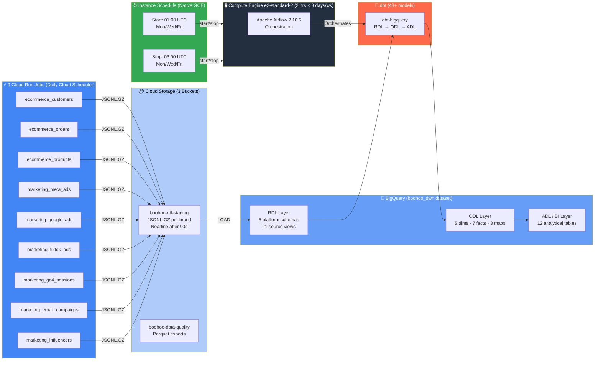

<p align="center">
  <h1 align="center">Boohoo Group Data Pipeline</h1>
  <p align="center">
    <strong>Multi-brand e-commerce data warehouse on GCP — 9 Cloud Run Jobs across 7 brands, BigQuery star schema, dbt medallion architecture (RDL → ODL → ADL), Airflow on a cost-optimised Compute Engine VM managed by Instance Schedules.</strong>
  </p>
  <p align="center">
    
    
    
    
    
    
    
    
    
  </p>
</p>

---

## Architecture Overview

A **production-grade, cost-optimised data warehouse** for the Boohoo Group's multi-brand e-commerce ecosystem. **9 Cloud Run Jobs** generate data for **7 brands** across **5 e-commerce platforms**, landing as JSONL.GZ in Cloud Storage. **BigQuery** warehouses the data through a **dbt-driven medallion architecture** (RDL → ODL → ADL) spanning **48+ models**. **Apache Airflow** runs on a **Compute Engine VM** that is automatically started and stopped by **Instance Schedules** — running just **2 hours, 3 days a week** to minimise costs.

### Brands & Platforms

| Brand | Platform | RDL Schema |
|-------|----------|------------|
| **Boohoo** | Boohoo Commerce | `rdl_boohoo_commerce` |
| **BoohooMAN** | Boohoo Commerce | `rdl_boohoo_commerce` |
| **PrettyLittleThing** | Salesforce Commerce Cloud | `rdl_salesforce_commerce` |
| **NastyGal** | Shopify | `rdl_shopify` |
| **Karen Millen** | Magento | `rdl_magento` |
| **Coast** | Magento | `rdl_magento` |
| **Debenhams** | Oracle Commerce | `rdl_oracle_commerce` |



### How It Works

1. **Cloud Scheduler** triggers **9 Cloud Run Jobs** daily at midnight UTC — each generates e-commerce and marketing data for all 7 brands, uploading JSONL.GZ to **Cloud Storage**
2. **Instance Schedule** starts the **Airflow VM** at **01:00 UTC** on Mon/Wed/Fri
3. **Airflow** orchestrates **GCS → BigQuery Load** jobs (defined in `copy_jobs.yml`) to load raw data into platform-specific RDL tables
4. **dbt** transforms the data through a **3-layer medallion architecture**: RDL (raw views) → ODL (dimensional model) → ADL (business analytics)
5. **Instance Schedule** stops the VM at **03:00 UTC**, keeping total compute to ~**6 hours/week** (~£2–4/month)
6. **BigQuery → GCS Export** jobs (defined in `export_jobs.yml`) export Parquet files for external consumption

---

## Tech Stack

| Layer | Technology | Details |
|-------|-----------|---------|
| **Data Warehouse** | BigQuery | `boohoo_dwh` dataset, EU location, on-demand pricing |
| **Storage** | Cloud Storage | 3 buckets: RDL staging, Terraform state, data quality. Lifecycle: Nearline at 90d, delete at 365d |
| **Data Generation** | Cloud Run Jobs (×9) | Python 3.11, containerised, 512 Mi, 5-min timeout. Multi-platform schema-aware generators |
| **Scheduling** | Cloud Scheduler | Daily job triggers + VM Instance Schedules (Mon/Wed/Fri) |
| **Cost Optimisation** | Instance Schedules | Native GCE feature — VM runs 2 hrs × 3 days/wk. ~£2–4/month compute |
| **Orchestration** | Apache Airflow 2.10.5 | LocalExecutor (cloud). GCS→BigQuery Load + dbt |
| **Transformation** | dbt (dbt-bigquery) | 48+ models: 21 RDL views + 15 ODL tables + 12 ADL tables |
| **Infrastructure** | Terraform | VPC, BigQuery, GCS, Cloud Run Jobs ×9, Cloud Scheduler, Compute Engine, IAM, Secret Manager |
| **Container Registry** | Artifact Registry | `boohoo-jobs` Docker repository |
| **Containerisation** | Docker Compose | Lightweight cloud stack (4 containers) |
| **CI/CD** | GitHub Actions | PR title enforcement (`DATA-<number>`) |
| **Language** | Python 3.11 | Cloud Run Jobs, Airflow DAGs, dbt model generator, scripts |

---

## Project Structure

```
boohoo-data-pipeline/
│
├── jobs/                                      # Cloud Run Job data generators
│   ├── Dockerfile                             # Shared container image for all 9 jobs
│   ├── requirements.txt                       # google-cloud-storage
│   ├── ecommerce_customers/main.py            # Generates customer data for all 7 brands
│   ├── ecommerce_orders/main.py               # Generates orders + order_items for all brands
│   ├── ecommerce_products/main.py             # Generates product catalogues for all brands
│   └── shared/
│       ├── config/ecommerce.py                # Multi-platform schemas, BRAND_SOURCES, ref data
│       ├── handler_logic.py                   # gen_customers, gen_orders, gen_products
│       └── utils.py                           # GCS upload helper (JSONL.GZ)
│
├── terraform/                                 # Full GCP infrastructure as code
│   ├── main.tf                                # Google provider, GCS backend, API enablement
│   ├── bigquery.tf                            # BigQuery dataset (boohoo_dwh)
│   ├── cloud_run_jobs.tf                      # 9 Cloud Run Jobs via for_each
│   ├── cloud_scheduler.tf                     # Daily triggers for all 9 jobs
│   ├── compute_engine.tf                      # Airflow VM + Instance Schedule (MWF start/stop)
│   ├── gcs.tf                                 # 3 buckets with lifecycle policies
│   ├── iam.tf                                 # Service accounts + Artifact Registry
│   ├── secret_manager.tf                      # Placeholder for future API keys
│   ├── variables.tf                           # Project ID, region, environment
│   └── outputs.tf                             # Endpoints, dataset IDs, bucket names
│
├── dbt/                                       # dbt transformation layer (48+ models)
│   ├── profiles.yml                           # BigQuery connection (OAuth + service-account)
│   ├── dbt_project.yml                        # Project: boohoo_dwh
│   ├── packages.yml                           # dbt-utils >=1.0.0
│   └── models/
│       ├── rdl/                               # Raw Data Layer — 21 source views
│       │   ├── boohoo_commerce/               # boohoo + boohoo_man (×3 each)
│       │   ├── salesforce_commerce/           # prettylittlething (×3)
│       │   ├── shopify/                       # nastygal (×3)
│       │   ├── magento/                       # karen_millen + coast (×3 each)
│       │   └── oracle_commerce/               # debenhams (×3)
│       ├── odl/                               # Operational Data Layer — 15 tables
│       │   ├── dim/                           # dim_customers, dim_products, dim_time, etc.
│       │   ├── fact/                          # fact_orders, fact_meta_campaign_insights, etc.
│       │   └── map/                           # map_brand, map_channel_grouping, map_utm_sources
│       └── adl/bi/                            # Analytics Data Layer — 12 BI tables
│
├── airflow/                                   # Airflow orchestration
│   ├── config/
│   │   ├── copy_jobs.yml                      # GCS → BigQuery Load definitions
│   │   └── export_jobs.yml                    # BigQuery → GCS Parquet Export definitions
│   ├── dags/
│   │   └── gcp_session.py                     # GCP credentials helper (ADC + service account)
│   ├── docker-compose.yaml                    # Full local stack (CeleryExecutor)
│   └── docker-compose.cloud.yaml              # Lightweight cloud stack (LocalExecutor)
│
├── scripts/
│   ├── build_images.py                        # Build & push Docker images to Artifact Registry
│   └── generate_dbt_models.py                 # Scaffold all RDL/ODL/ADL SQL models
│
├── .github/
│   ├── workflows/pr_title_checker.yml         # Enforce DATA-<number> PR title prefix
│   └── PULL_REQUEST_TEMPLATE.md               # PR template with checklist
│
└── boohoo/                                    # Brand configuration and data models
```

---

## Key Components

### ⚡ Cloud Run Job Data Generators

**9 Cloud Run Jobs** generate e-commerce and marketing data for all 7 brands, triggered daily by Cloud Scheduler:

| Job | Output | Description |
|-----|--------|-------------|
| `ecommerce_customers` | `{brand}/customers/` | Customer profiles per brand/platform |
| `ecommerce_orders` | `{brand}/orders/` + `order_items/` | Orders and line items |
| `ecommerce_products` | `{brand}/products/` | Product catalogues |
| `marketing_meta_ads` | `marketing/meta_ads/` | Meta (Facebook/Instagram) ad campaigns |
| `marketing_google_ads` | `marketing/google_ads/` | Google Ads performance |
| `marketing_tiktok_ads` | `marketing/tiktok_ads/` | TikTok ad insights |
| `marketing_ga4_sessions` | `marketing/ga4_sessions/` | Google Analytics 4 sessions |
| `marketing_email_campaigns` | `marketing/email_campaigns/` | Email engagement metrics |
| `marketing_influencers` | `marketing/influencer_posts/` | Influencer performance |

All jobs share a single Docker image pushed to **Artifact Registry** (`boohoo-jobs`). Each Cloud Run Job overrides the `CMD` at deploy time.

**GCS path pattern**: `raw/{source}/{brand}/{dataset}/ingest_date={yyyy-mm-dd}/{dataset}.jsonl.gz`

### ⏰ VM Cost Scheduler

The Airflow VM is managed by **native GCE Instance Schedules** — no extra functions needed:

| Component | Configuration |
|-----------|--------------|
| **Instance Schedule** | `boohoo-airflow-schedule` — Start Mon/Wed/Fri at **01:00 UTC**, Stop at **03:00 UTC** |
| **VM** | `e2-standard-2` — Debian 12, 20 GB pd-ssd, static external IP |
| **Runtime** | ~**6 hours/week** total (2 hrs × 3 days) |
| **Estimated cost** | ~**£2–4/month** |

### 🏢 BigQuery Data Warehouse

**Dataset**: `boohoo_dwh` | **Location**: EU | **Pricing**: On-demand

All tables live in a single dataset. dbt manages the logical layering:

| Logical Layer | Purpose |
|---------------|---------|
| `rdl_*` tables | Platform-specific raw data (21 views) |
| `odl_*` tables | Operational star schema (15 tables) |
| `bi_*` tables | Analytics / BI layer (12 tables) |
| `unit_test_*` tables | dbt test results |

### 🔄 dbt Medallion Architecture

The dbt project (`boohoo_dwh`) uses **dbt-bigquery** to transform data through three layers:

```
RDL (21 views)                ODL (15 tables)              ADL (12 tables)
─────────────                 ──────────────               ──────────────
Per-brand source views   →    Star schema dims/facts   →   BI-ready analytics
• Dedup via ROW_NUMBER        • dim_customers (UNION ALL   • fact_revenue_by_brand
• Platform-specific fields      + dedup by email)          • fact_daily_sales
• _history table reads        • dim_products (margin calc) • fact_customer_segments
                              • dim_time (date spine via   • fact_marketing_roas
                                GENERATE_DATE_ARRAY)       • fact_channel_performance
                              • fact_orders (surrogate     • ... (7 more)
                                keys, revenue calcs)
                              • 7 marketing fact tables
                              • 3 mapping tables
```

---

## Infrastructure (Terraform)

All infrastructure is provisioned as code in `europe-west2` (London) with GCS backend state:

| Resource | Details |
|----------|---------|
| **BigQuery** | `boohoo_dwh` dataset, EU location, on-demand pricing |
| **Cloud Storage** | 3 buckets: `boohoo-rdl-staging`, `boohoo-terraform-state`, `boohoo-data-quality` |
| **Cloud Run Jobs (×9)** | Containerised Python 3.11 data generators, 512 Mi, Artifact Registry images |
| **Cloud Scheduler (×9)** | Daily midnight UTC triggers for each Cloud Run Job |
| **Compute Engine** | `e2-standard-2`, Debian 12, 20 GB pd-ssd, static IP, Docker bootstrap |
| **Instance Schedule** | Native GCE start/stop: Mon/Wed/Fri 01:00–03:00 UTC |
| **IAM** | `boohoo-data-generator` SA (GCS + BQ), `boohoo-airflow-vm` SA (BQ admin + GCS + Run invoker) |
| **Artifact Registry** | `boohoo-jobs` Docker repository |
| **Secret Manager** | Placeholder for future API keys |

---

## Getting Started

### Prerequisites

- Google Cloud SDK (`gcloud`) configured
- A GCP project with billing enabled
- Terraform ≥ 1.0
- Docker & Docker Compose
- Python 3.11
- dbt-bigquery (`pip install dbt-bigquery`)

### 1. Provision Infrastructure

```bash
cd terraform
terraform init
terraform plan -var="gcp_project_id=YOUR_PROJECT_ID"
terraform apply -var="gcp_project_id=YOUR_PROJECT_ID"
```

### 2. Build & Push Cloud Run Job Images

```bash
python scripts/build_images.py --push
```

### 3. Run dbt Models

```bash
cd dbt
export GCP_PROJECT_ID=YOUR_PROJECT_ID
dbt deps
dbt run        # Build all models
dbt test       # Run quality checks
```

### 4. Start Airflow Locally

```bash
cd airflow
docker compose up -d

# Airflow UI → http://localhost:8081
```

---

## License

This project is for educational and portfolio purposes.
